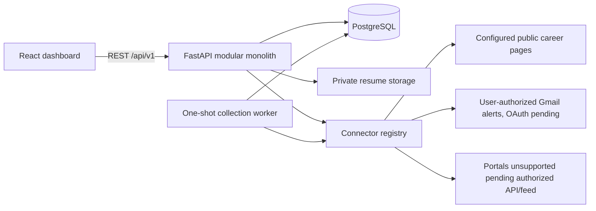

# Architecture

## System shape

Use a modular monolith: one FastAPI backend with domain modules and explicit service boundaries, one React TypeScript single-page frontend, and PostgreSQL as the durable store. A one-shot worker entry point can execute collection; recurring scheduling is not enabled.

## Important decisions

- **Human controlled workflow:** job approval, application-content approval, and manual submission confirmation are distinct states and audit events. No connector or AI workflow receives permission to submit applications.
- **Source boundaries:** connectors are independent adapters. Career page requests validate public destinations, respect robots.txt, and use bounded requests. Gmail is fail-closed until OAuth and sender allowlisting are configured. Portals without an authorized API/feed are reported unsupported; manual import is available.
- **Matching:** deterministic filters enforce hard constraints; semantic analysis can enrich scoring. Unknown compensation remains unknown.
- **Data protection:** resume storage is private; secrets come from environment configuration; external descriptions and messages are untrusted prompt input.
- **Persistence:** PostgreSQL stores core records, JSONB is reserved for flexible integration metadata, and migrations define schema evolution.
- **Frontend:** the React workspace provides source management, manual collection, run history, job filters, and manual import.

## Risks and integration limits

- Job portals differ in terms, APIs, access, and anti-bot controls; some requested connectors may be unavailable or require user-authorized exports/alerts.
- AI match quality depends on accurate resume parsing and job content; scores need explanation and user review.
- Resume and profile data are sensitive; private storage, access control, retention, and secret handling must be completed before accepting real user data.
- Collection uses durable run records, idempotent source-scoped upserts, and database locking. No recurring scheduler or unattended collection is enabled.
- Phase 1 health reports process liveness only; readiness and database checks come with persistence in Phase 2.
