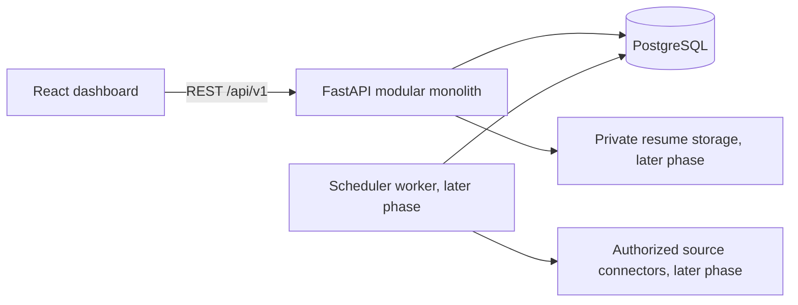

# Architecture

## System shape

Use a modular monolith: one FastAPI backend with domain modules and explicit service boundaries, one React TypeScript single-page frontend, and PostgreSQL as the durable store. A separate worker process will be introduced for scheduled collection once connectors and run records exist. This keeps early development operable without multiplying services while preserving module boundaries.

## Important decisions

- **Human controlled workflow:** job approval, application-content approval, and manual submission confirmation are distinct states and audit events. No connector or AI workflow receives permission to submit applications.
- **Source boundaries:** connectors are independent adapters. Integrations are enabled only where permitted access exists; no assumption of a public portal API and no evasion of access controls.
- **Matching:** deterministic filters enforce hard constraints; semantic analysis can enrich scoring. Unknown compensation remains unknown.
- **Data protection:** resume storage is private; secrets come from environment configuration; external descriptions and messages are untrusted prompt input.
- **Persistence:** PostgreSQL stores core records, JSONB is reserved for flexible integration metadata, and migrations define schema evolution.
- **Frontend:** typed API boundaries and reusable feature modules will be added as workflows arrive. The current page is a foundation shell, not a production workflow screen.

## Risks and integration limits

- Job portals differ in terms, APIs, access, and anti-bot controls; some requested connectors may be unavailable or require user-authorized exports/alerts.
- AI match quality depends on accurate resume parsing and job content; scores need explanation and user review.
- Resume and profile data are sensitive; private storage, access control, retention, and secret handling must be completed before accepting real user data.
- The scheduler needs durable run locking and idempotency before unattended collection is enabled.
- Phase 1 health reports process liveness only; readiness and database checks come with persistence in Phase 2.
