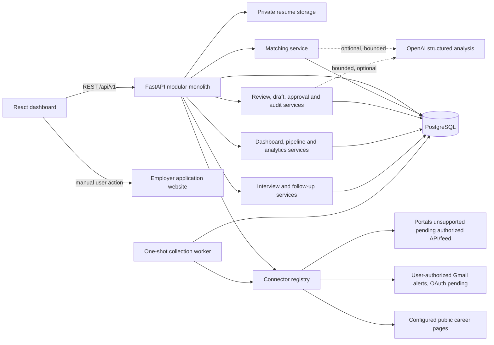

# Architecture

## System shape

Use a modular monolith: one FastAPI backend with domain modules and explicit service boundaries, one React TypeScript single-page frontend, and PostgreSQL as the durable store. A separate worker process handles six-hour scheduled collection, reminders, and outbox delivery; FastAPI startup does not own background schedules.

## Important decisions

- **Human controlled workflow:** job approval, exact document-version approval, final checklist approval, and manual submission confirmation are distinct states and audit events. No connector or AI workflow receives permission to submit applications.
- **Source boundaries:** connectors are independent adapters. Career page requests validate public destinations, respect robots.txt, and use bounded requests. Gmail is fail-closed until OAuth and sender allowlisting are configured. Portals without an authorized API/feed are reported unsupported; manual import is available.
- **Matching:** deterministic filters enforce hard constraints; semantic analysis can enrich scoring. Unknown compensation remains unknown.
- **Data protection:** resume storage is private; secrets come from environment configuration; external descriptions and messages are untrusted prompt input.
- **Persistence:** PostgreSQL stores core records, JSONB is reserved for flexible integration metadata, and migrations define schema evolution.
- **Matching:** explicit hard eligibility checks run separately from weighted scoring. Only criteria with enough data contribute; match fingerprints preserve history and prevent repeated model calls for identical inputs. AI analysis is optional, evidence-validated, and cannot override a deterministic hard mismatch.
- **Application preparation:** structured AI drafts cite supplied resume/job context; edits create new history versions. Final approval stores exact draft IDs and the checklist snapshot. Only the user's explicit confirmation sets an application to `APPLIED`.
- **Dashboard and tracking:** authenticated dashboard aggregates, application pipeline, timelines, notes, interviews, follow-ups, and analytics are queried from owned PostgreSQL records. Date filters are timezone-aware (Asia/Kolkata default); conversion percentages are withheld for samples smaller than five submissions.
- **Frontend:** the React workspace provides source management, manual collection, run history, job filters/import, match results, job review, document version review, approval checklist, manual handoff, dashboard, application pipeline, interview/follow-up management, and analytics.

## Risks and integration limits

- Job portals differ in terms, APIs, access, and anti-bot controls; some requested connectors may be unavailable or require user-authorized exports/alerts.
- AI match quality depends on accurate resume parsing and job content; scores need explanation and user review.
- OpenAI analysis requires backend credentials and incurs provider cost; it is disabled by default, rate limited in PostgreSQL, and bounded per batch.
- Resume and profile data are sensitive; private storage, access control, retention, and secret handling must be completed before accepting real user data.
- Collection uses durable source run records, source-scoped upserts, retries, timeouts, and per-source failure isolation. A PostgreSQL advisory lock elects one scheduler; unique run keys prevent duplicate scheduled ticks.
- Automation executions and heartbeats are persisted in PostgreSQL. Worker monitoring returns health and only the authenticated user's source metrics.
- Notifications use the existing user-owned inbox table as a transactional outbox, with per-event deduplication, persisted email delivery/retry state, and quiet-hour preferences. Email requires a configured SMTP provider and explicit user opt-in.
- Scheduled matching reuses the Phase 5 scoring service and fingerprint cache. Existing deterministic behavior is retained when AI is disabled or unavailable.
- Phase 1 health reports process liveness only; readiness and database checks come with persistence in Phase 2.
# Phase 9 security and runtime configuration

Authentication uses PostgreSQL-backed login throttling. A fixed-window record stores a SHA-256 fingerprint only, not the client IP or email. Production settings reject known development secrets, wildcard/insecure CORS origins, and incomplete SMTP credentials. OpenAPI docs are disabled with `APP_ENV=production`. Deployment still requires an independently configured TLS edge, network restrictions, secret storage, backups, and operational monitoring; the Compose/Vite setup is for local development.
